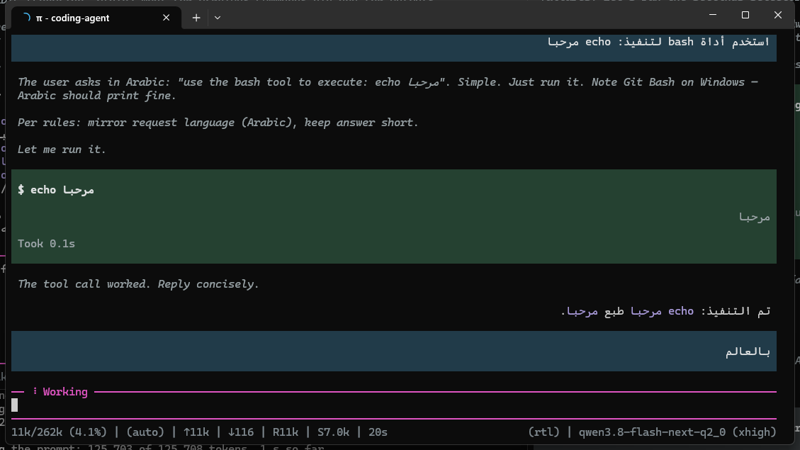
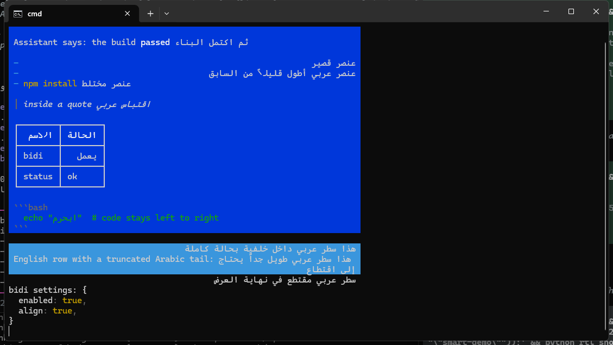
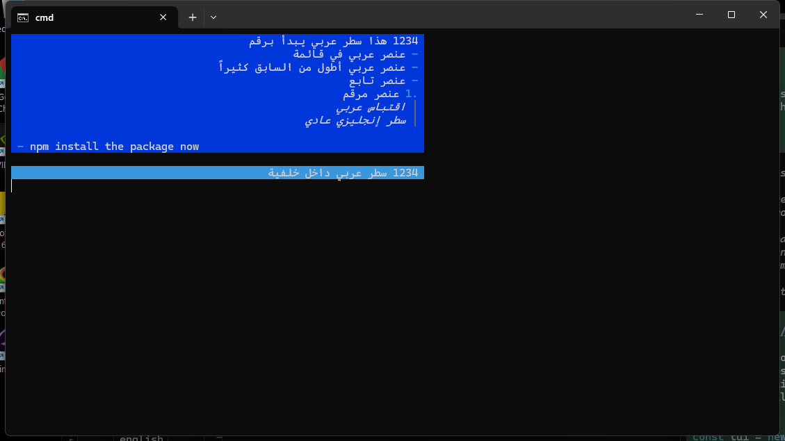
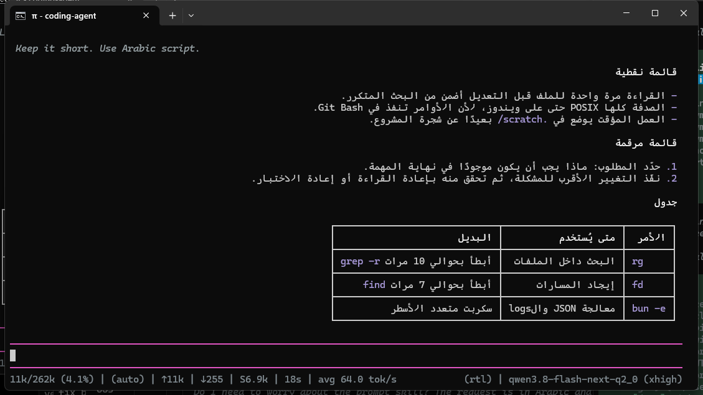

# Arabic (RTL) rendering for pi — the bidi patch

A fork of [pi](https://github.com/earendil-works/pi) whose only change is bidirectional
terminal rendering: an Arabic, Hebrew or Persian line is written to the terminal in the
order the reader sees it, and the line sits against the edge its script reads from.
Everything here is the diff from upstream tag **`v1.5.0`** to the `arabic-rtl-bidi`
branch — 33 files, +2258 / -113.

**RTL is off by default.** A line with no RTL content is rendered byte for byte as
upstream renders it.

## Proof

Rendered in Windows Terminal at 80 columns. Left: plain upstream. Right: this fork.

| Arabic answer, reordered | Mixed Latin + Arabic, aligned to the reading edge |
| --- | --- |
|  |  |
| Numbered list: the marker mirrors, the digit lands at the reading end | List and settings rows keep their columns while the RTL cells reorder inside them |
|  |  |

More in `rtl-patch/screenshots/`.

## Turn it on

In `~/.pi/agent/settings.json`:

```json
"terminal": { "rtl": { "enabled": true, "align": true } }
```

- `enabled` reorders the line into visual order.
- `align` puts the line against the edge its dominant script reads from (Arabic hugs the
  right edge, English the left).
- `PI_RTL=0` turns reordering off whatever the file says.

The settings list has **Bidirectional text** and **Align to the reading edge**.

## Apply it

Two Windows scripts, no source tree needed for the first:

| Script | What it does |
| --- | --- |
| `rtl-patch/rtl-apply-installed.bat` | Copies the patched `dist/*.js` from `rtl-patch/installed/` into the newest pi release under `~/.pi/agent/install/releases/`, vendors `bidi-js` so nothing is downloaded, backs up every file it touches, and finishes by running the patched `pi-tui`. `--check` reports, `--revert` restores. |
| `rtl-patch/rtl-apply-latest.bat` | Clones upstream, checks out the newest tag, applies `rtl-patch/pi-rtl-bidi.patch`, installs with `bun install --ignore-scripts`, runs the bidi tests. `--revert` returns the tree to plain upstream. |

By hand:

```sh
git clone https://github.com/earendil-works/pi pi-upstream
cd pi-upstream
git checkout v1.5.0
git apply /path/to/pi-rtl-bidi.patch
```

A release whose files do not match the `v1.5.0` build is skipped with a `SKIP` line
rather than guessed at — that means upstream moved past the patch base and the patch
needs rebuilding from this fork.

## Where the code is

- `packages/tui/src/bidi.ts` — the engine: embedding levels from `bidi-js`, per-line
  direction, grapheme-cell reordering that keeps styling, links and background with the
  cell that moved, bracket mirroring, and the caret/selection mapping.
- `packages/tui/src/components/*` — every component that writes a line to the terminal
  goes through `paintLine`: markdown, editor, input, text, truncated text, select list,
  settings list, scroll view, alt-screen search.
- `packages/coding-agent/src/core/settings-*` and the settings selector — the two
  settings and the UI that exposes them.
- `packages/tui/test/bidi-*.test.ts` — 78 tests covering reordering, alignment, caret
  placement, typing, mouse clicks, selection copy and settings.
- `rtl-patch/` — the patch file, the installed-pi kit, the apply scripts, the issue and
  PR text, and the screenshots above.

## Verify it

```sh
bun install --ignore-scripts
cd packages/tui
node --test test/bidi.test.ts test/bidi-text.test.ts test/bidi-markdown.test.ts \
  test/bidi-editor.test.ts test/bidi-settings.test.ts test/bidi-components.test.ts \
  test/bidi-selection.test.ts
```

Expected: 78 tests, all passing. Build the compiled files with
`bun x tsc -p packages/tui/tsconfig.build.json` and
`bun x tsc -p packages/coding-agent/tsconfig.build.json`; `node rtl-patch/gen-patch.mjs`
regenerates the patch from this tree and `node rtl-patch/build-installed-kit.mjs`
rebuilds the kit. Full details in `rtl-patch/README.md`.

## Dependency

`packages/tui` gains **`bidi-js` 1.1.0** — MIT, pure JavaScript, no native build. The
installed-pi route carries its own copy under `rtl-patch/installed/bidi-js/`, so no
network install is needed there.

## Status

Upstream issue [#11579](https://github.com/earendil-works/pi/issues/11579) and PR
[#11580](https://github.com/earendil-works/pi/pull/11580). Upstream auto-closes PRs from
new contributors; the PR is reopened from `arabic-rtl-bidi` once a maintainer replies
`lgtm`.
